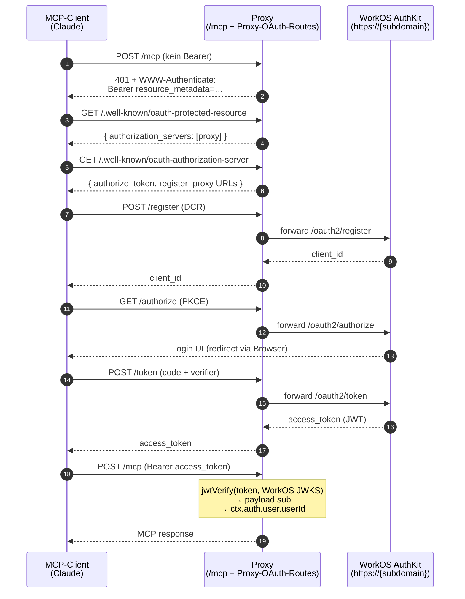
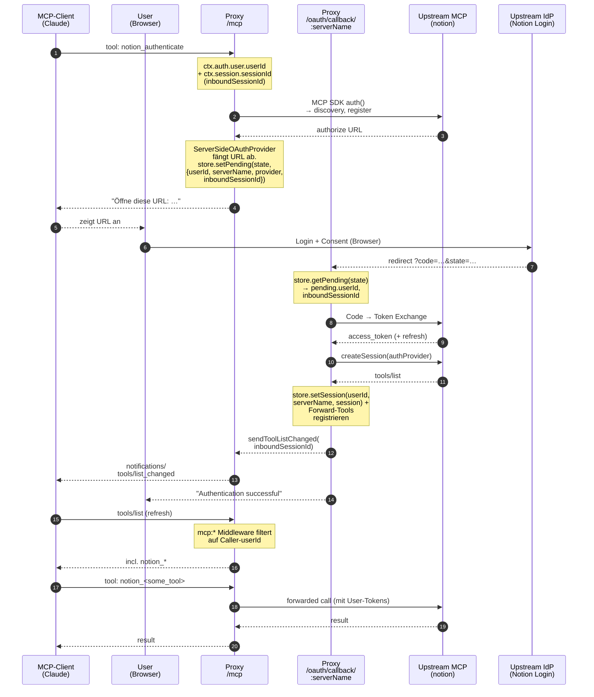

# MCP Proxy

Aggregiert mehrere Upstream-MCP-Server hinter einem einzigen MCP-Endpunkt. Der Proxy hat einen **eigenen** OAuth-Kontext (inbound) und verwaltet **pro User** einen **eigenen** OAuth-Kontext gegen jeden Upstream (outbound).

## Auth-Architektur

Es laufen zwei voneinander unabhängige OAuth-Flows:

| Schicht | Wer authentifiziert sich wo? | Wie? |
|---|---|---|
| **Inbound** | MCP-Client (z.B. Claude) → Proxy | Standard OAuth 2.1 + PKCE gegen **WorkOS AuthKit**. Verdrahtet via `oauthWorkOSProvider()` aus `mcp-use/server` — JWT-Verifikation gegen WorkOS JWKS, `userId = payload.sub`. Mit Dynamic Client Registration registriert sich der MCP-Client selbst — ohne vorab konfigurierte App in WorkOS. |
| **Outbound** | Proxy → Upstream-MCP-Server (z.B. `notion`) | Ein einziges `_authenticate`-Tool pro Upstream startet den Flow. Die Authorize-URL wird abgefangen statt im Browser zu öffnen — der User klickt sie selbst. Den Rest (Token-Tausch, MCP-Session aufbauen, Forward-Tools registrieren, Client benachrichtigen) macht der Browser-Callback automatisch. Pro `(userId, serverName)` getrennt. |

Wichtig: Die `userId` aus dem inbound Token (`ctx.auth.user.userId`, gemappt aus dem konfigurierten Claim — default `sub`) ist der **Schlüssel**, an dem outbound Tokens hängen. Dadurch:

- Reconnect mit gleichem Bearer ⇒ Upstream-Session wird wiederverwendet.
- Zwei verschiedene User können parallel denselben Upstream nutzen ohne sich in die Quere zu kommen.
- Niemand kann fremde Sessions ansprechen, weil jeder Tool-Aufruf gegen die verifizierte `userId` matched.
- Eine `mcp:*`-Middleware filtert die `tools/list`-Antwort pro Caller, sodass jeder User nur die `_authenticate`-Tools plus die Forward-Tools sieht für die er bereits authentifiziert ist. Kein Leak von fremden Auth-States.

### Inbound: MCP-Client → Proxy



> WorkOS-Provider läuft im **Proxy-Modus**: Discovery, `/authorize`, `/token`, `/register` werden vom Proxy gemountet und an WorkOS weitergereicht. Aus Sicht des MCP-Clients gibt es nur eine Gegenstelle (den Proxy), aus Sicht des Users öffnet sich trotzdem WorkOS' eigene Login-UI im Browser.

### Outbound: Proxy → Upstream-MCP-Server



## Setup

```bash
npm install
```

Pflicht-ENV (inbound OAuth via WorkOS AuthKit):

```bash
MCP_USE_OAUTH_WORKOS_SUBDOMAIN=your-tenant.authkit.app
```

Im WorkOS Dashboard unter **Connect → Configuration** muss **Dynamic Client Registration** aktiviert sein, sonst können sich MCP-Clients nicht selbst registrieren.

Optional:

```bash
MCP_USE_OAUTH_WORKOS_CLIENT_ID=client_…   # Vorab registrierter Client. Wenn gesetzt, wird DCR deaktiviert.
MCP_USE_OAUTH_WORKOS_API_KEY=sk_…         # Nur nötig wenn der Provider WorkOS-API-Calls macht.
BASE_URL=http://localhost:3000            # Wird für Upstream-Callback-URLs verwendet.
PORT=3000
```

Upstream-Server in `src/servers.json`:

```json
{
  "notion": {
    "url": "https://mcp.notion.com/mcp",
    "clientName": "Notion"
  }
}
```

Starten:

```bash
npm start
```

## Verifizieren

```bash
# Discovery erreichbar
curl http://localhost:3000/.well-known/oauth-protected-resource

# /mcp ohne Bearer → 401 + WWW-Authenticate
curl -i -X POST http://localhost:3000/mcp \
  -H 'content-type: application/json' \
  -d '{"jsonrpc":"2.0","id":1,"method":"initialize","params":{}}'

# Upstream-Callback bleibt offen (kein Bearer nötig)
curl -i http://localhost:3000/oauth/callback/notion
```

## Deployment auf Fly.io

Es liegen `Dockerfile`, `.dockerignore` und `fly.toml` im Repo. Drei wichtige Eigenheiten der Architektur, bevor du deployst:

1. **Single Machine.** Per-User-Sessions und Upstream-OAuth-Tokens liegen alle in-memory. Bei zwei oder mehr Maschinen würden Auth-Callbacks aus dem Browser auf der falschen Instanz landen. `fly.toml` setzt `min_machines_running = 1`, `auto_stop_machines = false` und `strategy = "immediate"`. Niemals horizontal skalieren.
2. **`baseUrl` muss zur öffentlichen URL passen.** Ist aktuell in `src/index.ts` hartkodiert (für lokales Tunneln per ngrok). Vor dem ersten Deploy auf den Fly-Hostnamen ändern, z.B. `baseUrl: "https://mcp-proxy.fly.dev"`. Die WorkOS-Discovery (`/.well-known/oauth-authorization-server`) und die Upstream-Callback-URL leiten sich beide daraus ab — wenn das nicht stimmt, kommen weder Inbound-Clients noch Upstream-IdPs zurück.
3. **WorkOS-Subdomain.** Steckt aktuell ebenfalls hartkodiert in `src/index.ts`. Falls du das production-/staging-trennen willst, auf eine ENV-Variable umstellen (`oauthWorkOSProvider({ subdomain: process.env.WORKOS_SUBDOMAIN })`) und entsprechend in `fly.toml` setzen.

Erstdeployment:

```bash
fly launch --no-deploy --copy-config   # liest fly.toml, app-Name evtl. anpassen
fly deploy
```

Health-Check und Port-Mapping sind in `fly.toml` vorkonfiguriert. Der Container bindet auf `0.0.0.0:3000` (`HOST=0.0.0.0` aus dem Dockerfile), Fly leitet 443/80 auf 3000 weiter.

Lokal smoketesten:

```bash
docker build -t mcp-proxy:test .
docker run --rm -p 3000:3000 -e BASE_URL=http://localhost:3000 mcp-proxy:test
curl http://localhost:3000/.well-known/oauth-protected-resource
```

## Dateien

| Datei | Verantwortung |
|---|---|
| `src/index.ts` | MCPServer-Setup, Inbound-OAuth-Provider (WorkOS), Tool-Registrierung, Upstream-Callback-Route, `mcp:*` Filter-Middleware |
| `src/oauth-provider.ts` | `ServerSideOAuthProvider` — fängt outbound Authorize-URL ab statt Browser zu öffnen |
| `src/session-store.ts` | Per-`userId` Sessions + Pending OAuth State |
| `src/servers.json` | Liste der aggregierten Upstream-MCP-Server |
| `Dockerfile` | Node-22-Slim Build mit `tsx` als Runtime; bindet auf `0.0.0.0:3000` |
| `fly.toml` | Single-Machine-Konfig, Health-Check auf Discovery-Endpoint |

## Out of Scope

- **Token-Persistenz**: Tokens sind in-memory. Server-Restart ⇒ alle User müssen sich erneut bei den Upstreams authentifizieren.
- **Refresh-Handling**: Abgelaufene Upstream-Tokens werden nicht automatisch erneuert.
- **Logout**: Keine `_logout` Tools — nur Server-Restart räumt auf.
